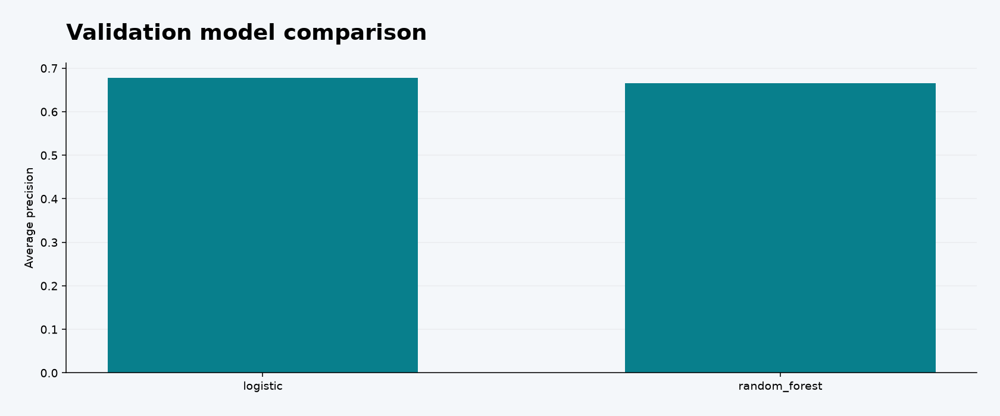

# Churn Decision Engine

Can a held-out risk ranking prioritize a limited retention budget, and how sensitive is that decision to unobserved treatment effectiveness?

Held-out ROC AUC **0.833**, AP **0.625** and **2.32× lift** in the highest-risk 20%. Results measure retrospective ranking, not saved revenue.



## Run locally

Tested with Python 3.13. Install the pinned dependencies in an isolated environment:

```bash
python3 -m venv .venv
source .venv/bin/activate
python -m pip install -r requirements.txt
python -m unittest -v
python pipeline.py
```

On Windows use `.venv\Scripts\activate` for activation. The first pipeline run downloads the public source into `.cache/` (except the synthetic experiment). Later runs reuse it. Delete only that cache if you intentionally want a fresh source download. `metrics.json` records the source SHA-256 so a changed upstream dataset can be detected.

Open **dashboard.html** locally for interactive charts, zoom, hover and legend toggles. It is self-contained and needs no API key, server or CDN. GitHub displays HTML source rather than running dashboards: download the repository ZIP, extract it, then open the file. Read [FINDINGS.md](FINDINGS.md) for the decision memo and [analysis.ipynb](analysis.ipynb) for the walkthrough.

## Analysis architecture

```text
Source validation → stratified train/validation/test split → fitted preprocessing → model selection → held-out ranking/calibration → policy sensitivity.
```

- Uses a 60/20/20 customer split, with imputation, scaling and encoding fit inside each training pipeline.
- Compares logistic regression and random forest using validation average precision; touches test outcomes only after selection.
- Reports ROC AUC, average precision, Brier score, PR curve, calibration bins and a 500-resample bootstrap AP interval.
- Evaluates a pre-specified top-20% contact capacity and reports capture, precision and lift.
- Measures original-feature permutation importance and varies hypothetical save probability and budget. No causal uplift is claimed.

## Data and metric contracts

`customerID`: unique ID, excluded from modeling. `Churn`: binary outcome, Yes/No. `tenure`: months. `MonthlyCharges`, `TotalCharges`: source monetary units; blanks in TotalCharges become missing. `Contract`, `PaymentMethod` and service categories: predictors. `test_predictions.csv` contains only anonymous labels and risk scores. Protected/demographic attributes are excluded from the feature set; exclusion alone does not establish fairness.

Source attribution, download policy and license boundaries are in [DATA.md](DATA.md). KPI denominators and decision rules are explicit in the pipeline. Generated results are committed so the conclusions can be inspected without executing code.

## Outputs

`validation_models.csv`, `test_predictions.csv`, `permutation_importance.csv`, `policy_scenarios.csv`, `metrics.json`.

`pipeline.py` owns analytical calculations; `reporting.py` only downloads, fingerprints and renders. SQL files provide the corresponding warehouse-style aggregations. `test_pipeline.py` checks failure modes such as temporal leakage, invalid capacities, duplicate handling or SRM gating. [VALIDATION.md](VALIDATION.md) records the executed checks.

## Limitations and decisions

The sample has no prospective outcome horizon or trustworthy event timestamps, so a random split supports only retrospective ranking. Predictions are not calibrated by a separate calibration model. The dashboard exposes calibration quality. Risk is not treatment effect; hypothetical economics require a retention experiment.

## Next engineering step

Collect as-of timestamps and label windows, evaluate out-of-time performance, and estimate treatment response with a randomized pilot.

## License

MIT for project code. Third-party data keep their source terms. See [LICENSE](LICENSE) and [DATA.md](DATA.md).
